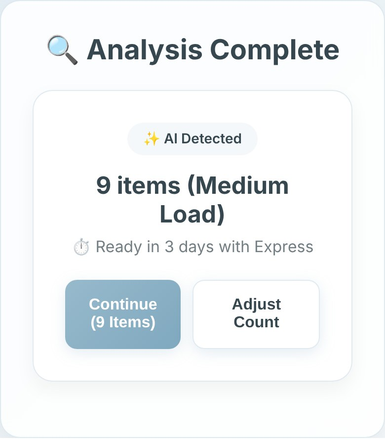
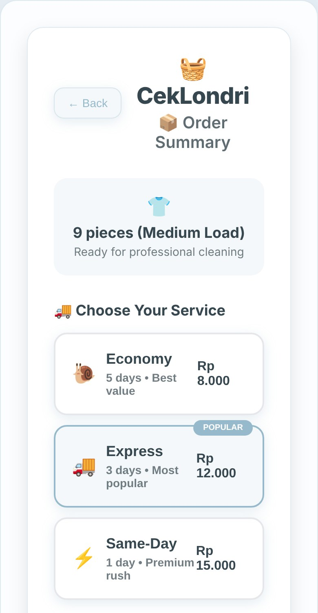
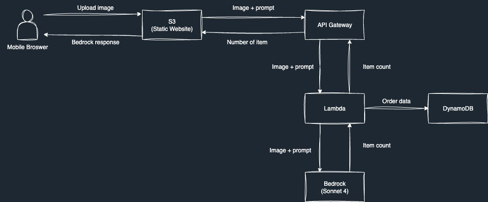

## The problem

Have you ever dropped off laundry and gotten it back one shirt short? In Indonesia, most laundry shops still count clothes by hand on a paper slip. The customer says they dropped off 20 items, the slip says 18, and nobody can prove who's right.

I read through Google reviews of Jakarta laundry shops and the pattern was clear: lost items, miscounts, and arguments that ended with refunds, one-star reviews, or customers leaving for good. The fix isn't better customer service. It's a count both sides can trust.

## What I built

CekLondri lets a vendor take one photo of the pile at drop-off. AI counts the items in about 30 seconds, and the customer gets a digital receipt on WhatsApp with the photo as proof.

The result screen. The vendor can accept the count or adjust it by hand, so the AI is never the final word.

A few design choices made it work in practice:

- **Three counts, not one.** Each photo is analyzed three times and the app takes the most common answer, which smooths out the occasional bad guess.
- **It rejects bad photos.** Pictures of people wearing clothes, or with no clothes at all, are flagged instead of counted.
- **Built for how Indonesian laundry actually works.** Per-item pricing with Economy, Express, and Same-Day tiers, plus pickup or drop-off.

After the count: choose a service tier and delivery method, see the price breakdown, schedule a pickup.

## How it works

A static site on S3 sends the photo through API Gateway to a Lambda function, which asks Amazon Bedrock (Claude Sonnet 4) to count the items. Orders are saved in DynamoDB.

At 1,000 counts a month, the whole thing costs under $16 to run, almost all of it the AI calls. That's small next to the cost of one customer who never comes back.

## How it came together

The idea started over a lunch one-on-one with my mentor. From there I followed Amazon's Working Backwards process: a press release and FAQ first, revised until the customer problem was sharp, then design, then code. I'd never built a full app before, so I learned to build with AI coding tools along the way, then spent the last stretch fixing bugs, adding image compression, connecting the database, and demoing to Solutions Architects for feedback. I presented the final version, including the business case and costs, to 20+ Solutions Architects.

## What I'd do next

- Talk to laundry vendors in person, in Bahasa Indonesia, before building more.
- Support both pricing models the industry uses: per item (*satuan*) and per kilo (*kiloan*).
- Add owner, staff, and customer accounts, plus period reports from the order database.

## What I learned

The first version of my pitch led with the technology. The better version led with the angry customer holding a slip that says 18. People remember the problem, not the architecture.
