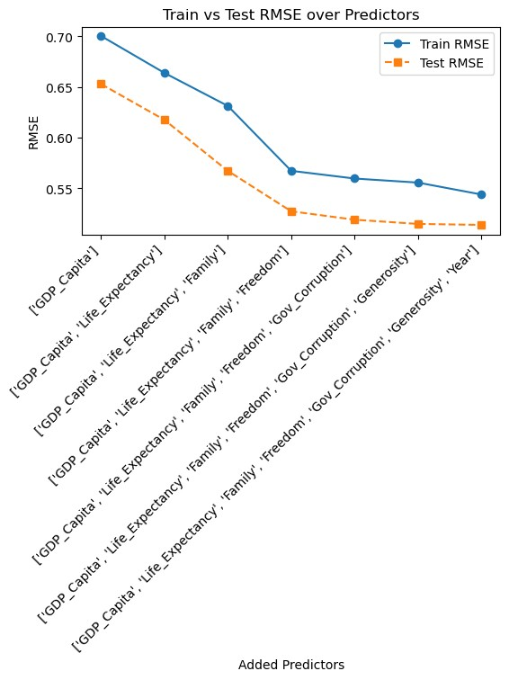

*Solo project for Data Science 2 with Python (STAT 303-2).*

## The question

Is national happiness mostly about money? I wanted to test whether wealth alone explains how happy countries say they are, or whether things like freedom, social support, and generosity matter on their own.

## The data

World Happiness Report data for 2015–2019 ([source](https://www.kaggle.com/datasets/unsdsn/world-happiness)): 781 country-year observations after cleaning, with a happiness score and six factors: GDP per capita, life expectancy, family and social support, freedom, trust in government, and generosity.

## How I built the model

I started with GDP alone, then added predictors one at a time in order of how strongly each correlated with happiness, watching prediction error on held-out data.

Error drops sharply through freedom, then flattens: the last few predictors add little.

I then tested interaction terms (whether one factor matters more when another is high) and used Ridge regularization with cross-validation to keep the model from overfitting. Train and test error ended up nearly identical (0.511 vs. 0.509), a good sign the model generalizes.

## What I found

The final model explained 78% of the variation in happiness (R² 0.781).

- **Money matters, but it isn't the whole story.** GDP per capita was significant (p = 0.012).
- **Freedom matters on its own.** Freedom to make life choices was significant even after accounting for wealth (p = 0.003).
- **Health and social support work together.** The combination of life expectancy and family support was significant (p = 0.003), even though neither was on its own.
- **Wealth and generosity interact.** Generosity's link to happiness depended on how wealthy a country was (p = 0.021).

## So what

For policymakers, the takeaway is that growth alone won't buy happiness. Protecting personal freedom and investing in health *alongside* strong social support show up as separate, measurable effects.

## What I learned

The interesting findings were in the interactions, not the headline variables. Asking "when does this matter?" got further than "does this matter?"
