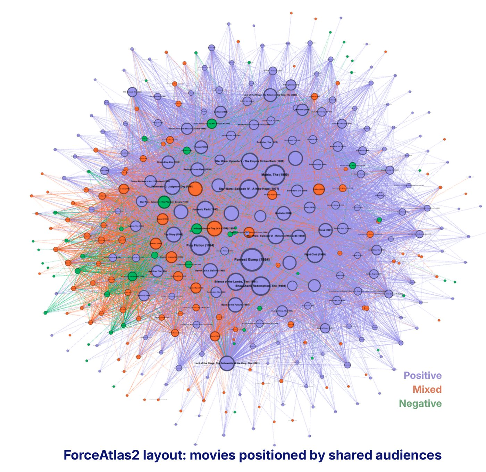

*Built in Social Networks Analysis (IEMS 341) with Amelia Hasting, Jack Elice, and Pietro Prisco de Sousa.*

## The question

Most recommendation systems assume that if people watched the same movies, they'll like the same movies. But people watch things because they're popular, available, or everyone's talking about them. **Watching isn't liking.**

So instead of asking "what does this user like?", we asked "how are movies connected through the people who watch them?"

## How we built the network

From MovieLens (610 users, 100,836 ratings) we built a network where each movie is a dot and two movies are linked when the same people rated both. Keeping only strong links (50+ shared ratings) left 351 movies and 9,912 links. We tagged each movie as positive, mixed, or negative by its average rating.

Movies pulled together by shared audiences. Purple = positively rated, orange = mixed, green = negative.

## What we found

- **No clean taste groups.** Modularity, a measure of how strongly a network splits into communities, was 0.183, well below the 0.3 threshold for meaningful structure. Co-watching alone doesn't sort people by taste.
- **Lots of overlap, not shared taste.** A clustering coefficient of 0.803 shows heavy audience overlap, but overlap doesn't prove people liked the same films for the same reasons.
- **Classics dominate.** Forrest Gump, The Matrix, and Star Wars sit at the center, making it hard to tell real fans from casual viewers.
- **Bridge movies matter.** Films like Jurassic Park connect communities without being the most popular.
- **Hidden differences.** One community had a 27% negative rating rate versus 8% in another, a difference co-watching data hides.

## What we'd tell a streaming platform

Weight links by shared *positive* ratings, not just shared viewing. Downweight mega-popular titles. Use genre as a backup signal when a user's history is thin. And use bridge movies to recommend across taste groups.

## What I learned

A "no result" is still a result. The low modularity was the finding, and it pointed straight at the fix.
