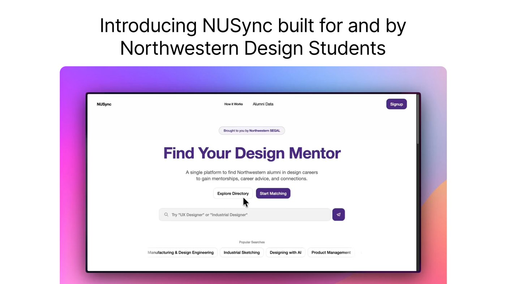
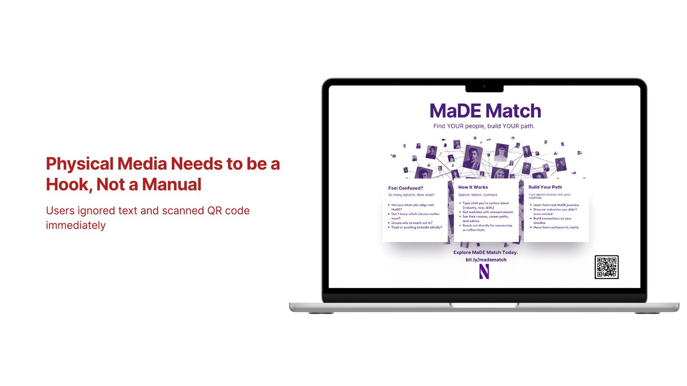
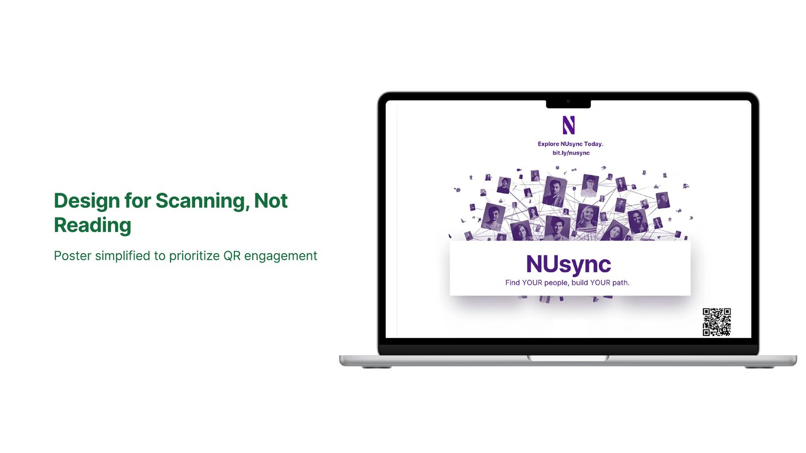
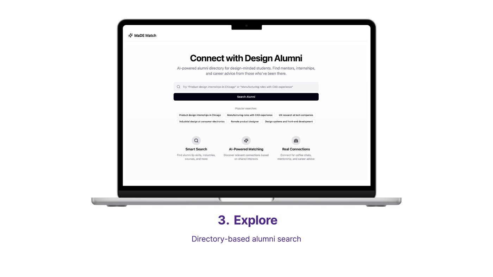
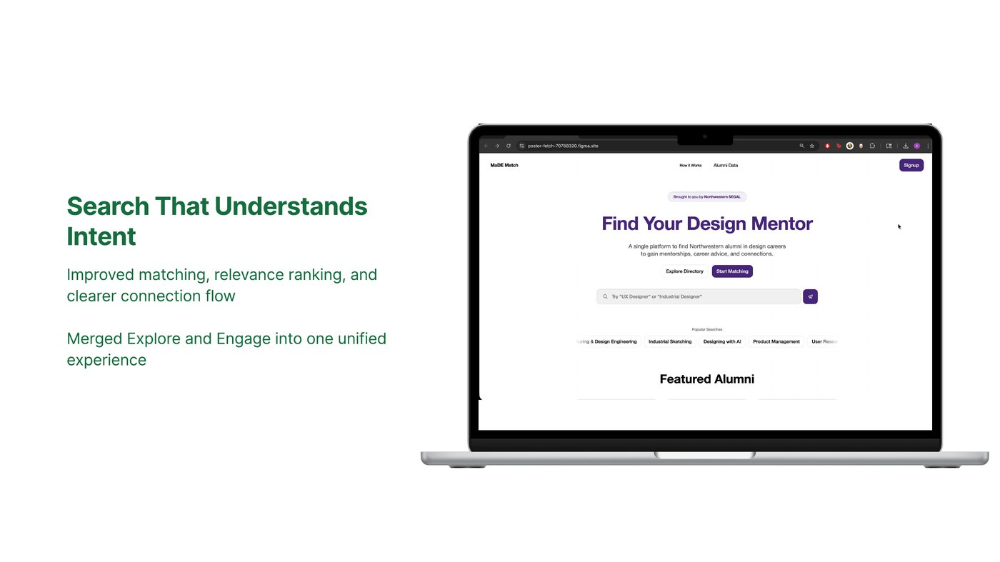
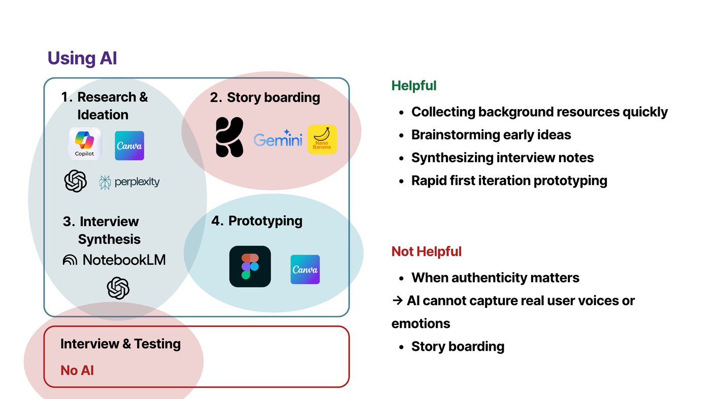

*Built in Designing with AI (DSGN 395) with Ami Takamatsu, Fai Poungpeth, and Jason Jeong.*

## The problem

Design students at Northwestern don't know where to start. Professional resources are scattered, there's little career guidance, and reaching alumni or upperclassmen means knowing who to ask before you know what to ask.

## The idea

A single place to find design mentors by what you care about (interests, fields, skills, student orgs) instead of by names you don't know yet. It started as **MaDE Match**, for Manufacturing and Design Engineering students, and grew into **NUSync**.

## What testing changed

We designed and tested three touchpoints: how students first hear about it, the landing page, and the search. Each one changed after watching real users.

**1. The poster.** Our first flyer explained everything. Students ignored the text and went straight for the QR code. So we stopped designing for reading and designed for scanning.

**2. The landing page.** It tried to explain features and show analytics at once. Users kept scrolling to piece the story together. We merged the landing page and search into one experience.

**3. The search.** Results weren't always relevant, and it wasn't clear how to actually connect with someone. We improved matching and ranking so search understands intent, and made the connection flow obvious.

## Where we used AI, and where we didn't

The class was about designing *with* AI, so we tracked it. AI helped with research, early brainstorming, storyboarding, synthesizing interview notes, and fast first prototypes. We kept it out of interviews and testing entirely, because AI can't capture a real user's voice or frustration.

Our rule of thumb: **trust AI** when the output can be checked against known facts, when it's structuring or summarizing, and when uncertainty is low. **Override it** when suggestions are generic, when it misses small details that matter, or when the decision depends on what real users think.

## What I learned

The most useful feedback was what people *did*, not what they said. Nobody told us the poster had too much text. They just skipped it.
